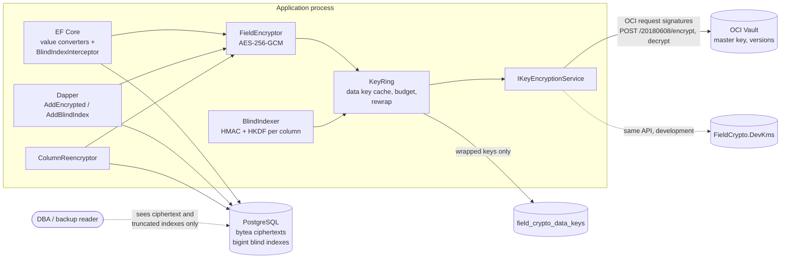
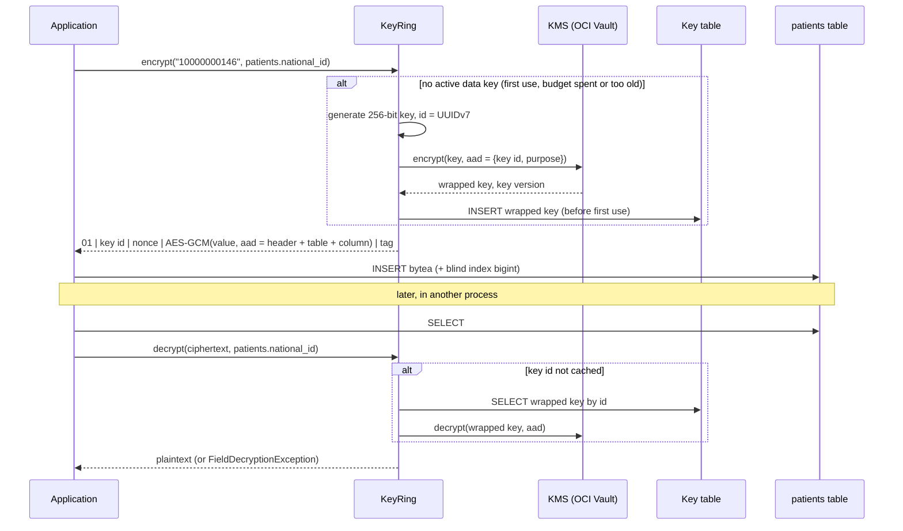

# field-crypto

[](https://github.com/hekimcan206/field-crypto/actions/workflows/ci.yml)
[](https://github.com/hekimcan206/field-crypto/actions/workflows/codeql.yml)


[](LICENSE)

Field-level encryption for .NET 10: **envelope encryption** (AES-256-GCM data keys wrapped by a KMS), **key rotation**
at two levels (rewrap the KEK without touching a data row; retire a data key and re-encrypt online), **blind indexes**
for equality search on encrypted columns, a pluggable KMS with an **OCI Vault adapter** and a **local development KMS**,
and **EF Core and Dapper** integration.

> All data is synthetic: patients, national ids, e-mails and notes are generated. There is no real personal or health
> data.

## Problem

Encrypting the disk or the whole database protects against a stolen disk. It does nothing against the people who can
query the database: DBAs, analysts with read access, whoever holds a backup or a replica. For a handful of columns
(national id, name, phone, clinical notes) that is the threat that matters. Doing it at the field level raises four hard
questions:

1. **Where is the key, and what does it cost?** A key in configuration sits next to the data. A KMS call per value is
   slow, rate-limited and billed.
2. **How do you rotate?** Re-encrypting every row whenever the KMS key rotates does not scale; and sometimes a data key
   itself must go.
3. **How do you search?** Randomised encryption makes `WHERE national_id = @x` impossible; deterministic encryption leaks
   every duplicate.
4. **What stops a DBA from moving ciphertexts around**, for example copying patient A's diagnosis onto patient B?

## Solution

| Concern | How |
|---|---|
| Key cost | Envelope encryption: 256-bit data keys wrapped by the KMS, stored in a key table, referenced by a 16-byte id in each ciphertext, cached unwrapped in the process. 10,000 patients (50,000 values) cost **2 KMS wraps**; without the cache, 300 patients cost 1,429 ([ADR 0001](docs/adr/0001-envelope-encryption-with-referenced-data-keys.md)) |
| Safe AES-GCM use | Random 96-bit nonces under a per-key budget (default 10^6, hard cap 2^32 per NIST SP 800-38D), enforced under concurrency ([ADR 0002](docs/adr/0002-aes-gcm-random-nonces-message-budget-and-context-binding.md)) |
| Ciphertexts moved around | Header + table + column (+ row key when known) authenticated as GCM associated data: a copy to another column fails, a copy to another row fails for row-bound columns |
| KEK rotation | `RewrapAsync`: one unwrap + wrap + compare-and-set per **data key**, zero data rows touched; also migrates between KMSs ([ADR 0003](docs/adr/0003-two-level-rotation.md)) |
| Data key retirement | `ColumnReencryptor`: finds rows by the key id in the ciphertext header in SQL, re-encrypts in batches with one guarded `UPDATE ... FROM unnest(...)`, never overwrites a concurrent application write |
| Search | Truncated HMAC-SHA256 blind indexes under per-column HKDF keys, a planner for the bit length, Turkish-aware normalisation, false positives filtered after decryption ([ADR 0004](docs/adr/0004-truncated-hmac-blind-indexes.md)) |
| KMS | `IKeyEncryptionService` with real sync and async paths; OCI Vault adapter with OCI request signing and no SDK; `FieldCrypto.DevKms` serves the same API locally and verifies signatures ([ADR 0005](docs/adr/0005-oci-vault-adapter-without-sdk-and-a-development-kms.md)) |
| ORM | EF Core: `IsEncrypted`, `HasBlindIndex`, interceptor, `WhereBlindIndexMatchesAsync` (column-bound). Dapper: `AddEncrypted` / `AddBlindIndex` (row-bound) ([ADR 0006](docs/adr/0006-ef-core-column-bound-dapper-row-bound.md)) |

## Architecture



Write and read of one value:



## The demo

```bash
docker compose up        # PostgreSQL 17, the development KMS (OCI Vault API) and the demo; exits when done
```

It seeds 2,000 synthetic patients through EF Core and 200 lab notes through Dapper, then checks every claim and fails
the run if one does not hold. Output from this machine (abridged only where marked):

```text
=== 1. Seed 2,000 synthetic patients (EF Core) and 200 lab results (Dapper)
  seeded in 3.9 s; 20 data keys (500 encryptions each), 21 KMS wraps

=== 2. What a database reader sees
  national_id = \x0101a1d547dc777bfba7b55bc0362cf1613077e10def0955... (56 bytes), national_id_index = 11762
  searched every encrypted column for 200 known plaintexts: 0 hits

=== 3. Search through blind indexes
  national id "558 714-63010": 1 candidate rows, 1 match after decryption (0 false positives, expected ~0.0)
  surname "IŞIK": 69 patients named Işık (69 candidates)
  e-mail typed in upper case with spaces: 1 match (1 candidates)

=== 4. Tampering
  national_id of one patient copied into another patient's phone column: DETECTED
  lab note copied to another row (Dapper, row-bound): DETECTED
  national_id copied to another row (EF Core, column-bound): NOT detected, as documented: EF value converters have no row context

=== 5. KEK rotation: rewrap data keys, touch no data row
  new KEK version ocid1.keyversion.oc1.dev.fieldcrypto.demo.2; rewrapped 21 of 21 keys in 281 ms; data rows changed: 0
  cold-cache process decrypted 2,000 patients after the rotation

=== 6. Retire every data key and re-encrypt online
  patients: 2,000 rows in 0.42 s (4,814 rows/s, 5 columns each), conflicts 0
  lab_results: 200 rows (row-bound), conflicts 0; rows left on retired keys: 0

{"patients":2000,"labResults":200,"dataKeys":20,"plaintextHits":0,"nationalIdCandidates":1,"nationalIdMatches":1,"surnameMatches":69,"crossColumnCopyDetected":true,"rowCopyDetectedDapper":true,"rowCopyDetectedEfCore":false,"kekRewrapped":21,"dataRowsChangedByKekRotation":0,"rowsReencrypted":2200,"rowsLeftOnRetiredKeys":0,"failures":[]}
```

The demo uses a budget of 500 encryptions per data key so that rotation has several keys to work on; the library
default is 1,000,000. The same scenario runs in the integration suite against both KMS implementations, and CI runs the
compose demo on every push and asserts the summary.

## Usage

```csharp
// One key ring per process: OCI Vault in production, the local KEK in development.
var kms = OciVaultKeyEncryptionService.Create(
    new OciVaultOptions { CryptoEndpoint = cryptoUrl, ManagementEndpoint = managementUrl, KeyId = keyOcid },
    OciApiKey.FromPem(tenancyOcid, userOcid, File.ReadAllText(apiKeyPath)));
var ring = new KeyRing(kms, new PostgresDataKeyStore(dataSource));
await ring.InitializeAsync();
var encryptor = new FieldEncryptor(ring);
var indexer = new BlindIndexer(ring);

// EF Core
patient.Property(p => p.NationalId).IsEncrypted(encryptor);
patient.HasBlindIndex(p => p.NationalId, p => p.NationalIdIndex,
    new BlindIndexDefinition("patients", "national_id", bits: 16, TextNormalizers.DigitsOnly));
options.AddInterceptors(new BlindIndexInterceptor(indexer));
var found = await db.Patients.WhereBlindIndexMatchesAsync(indexer, p => p.NationalId, "100 000 001 46");

// Dapper, row-bound
var p = new DynamicParameters(new { id }).AddEncrypted("note", note, encryptor, new EncryptionContext("lab_results", "note", id.ToString()));

// Rotation
await ociVault.CreateKeyVersionAsync();   // or rotate in the console
await ring.RewrapAsync();                 // O(data keys), no data rows
await ring.RetireActiveDataKeyAsync();    // then, per table:
await new ColumnReencryptor(dataSource, encryptor).ReencryptRetiredAsync(target);
```

## Why this design

- **Reference data keys, do not inline them.** An inline wrapped key makes every value carry a KMS ciphertext (an OCI
  ciphertext of a 32-byte key is longer than ten national ids) and makes a KEK rotation rewrite every row. A 16-byte id
  keeps the overhead at 45 bytes and the KEK rotation at the size of the key table.
- **Budget the data key, not the nonce.** GCM with random nonces is safe up to a message count; enforcing that count
  under concurrency in the key ring is simpler and testable, and keeps the BCL's hardware-accelerated `AesGcm`.
- **Put the location in the associated data.** Tamper detection that ignores *where* a ciphertext sits misses the attack
  that matters in a patient table: a valid ciphertext in the wrong row. Where row binding is impossible (EF Core
  converters), the repo says so and shows it, instead of implying protection it does not give.
- **Truncate blind indexes on purpose.** A full-length HMAC is a deterministic pseudonym: it links every duplicate.
  Truncation trades a measured number of extra decryptions for buckets that mix many people.
- **Fold all four Turkish i letters.** Neither invariant nor Turkish culture casing makes "İrem", "IREM" and "irem" equal;
  a search that misses a patient because of a keyboard layout is a correctness bug.
- **No OCI SDK, but test against OCI's documented example.** Four calls do not justify the SDK, and the synchronous path
  EF Core needs is first-class here. The signer is checked against the signing string published by Oracle, and the
  adapter runs over real HTTP against a development KMS that enforces the same signature rules.

## Quick start (development)

```bash
dotnet test                                                  # unit, property, golden, OCI adapter and Testcontainers tests
docker compose up -d postgres devkms                         # PostgreSQL on 127.0.0.1:58962, DevKms on 127.0.0.1:58961
docker compose cp devkms:/client .devkms                     # the generated client API key (git-ignored)
FC_KMS_CLIENT_KEY_DIR=.devkms dotnet run --project samples/FieldCrypto.Demo
```

## Results (measured)

Laptop i7-13620H, Windows 11, Docker Desktop (WSL2), PostgreSQL 17 in Docker, development KMS over loopback HTTP,
**shared and loaded host** (another agent's benchmark ran concurrently; CPU 46-74 %). Medians of 3 runs, every run in
[docs/benchmarks.md](docs/benchmarks.md).

| Measurement | Result |
|---|---|
| Encrypt / decrypt an 11-digit national id (warm cache) | 1.39 µs / 1.18 µs |
| Blind index, Turkish fold | 0.60 µs |
| KMS unwrap over the OCI API (loopback DevKms), p50 | 1.67 ms async, 1.63 ms sync |
| EF Core insert, 10,000 patients x 5 encrypted fields | 3,014 patients/s with **2 KMS wraps** vs 14,466 plaintext |
| Same without the data key cache (key per value) | 72 patients/s, 1,429 KMS wraps for 300 patients |
| Cold read of 10,000 patients by a new process | 396 ms, **1 KMS unwrap** |
| Lookup by national id via 16-bit blind index, p50 | 1.13 ms (plaintext b-tree 0.67 ms), 1.15 candidates (expected 1.15) |
| False positives at 100,000 rows, 12 / 16 / 20 bits | 24.6 / 1.48 / 0.13 per lookup (formula: 24.4 / 1.53 / 0.10) |
| KEK rotation, 1,000 data keys | 4.5 s (4.5 ms per key), **0 data rows touched** |
| Data key retirement, re-encryption | 8,626 rows/s (5 columns per row), 0 lost concurrent writes in the test |
| Storage, national id | 57 bytes encrypted vs 12 plaintext |

## Limitations and next steps

- **Not run against a live OCI tenancy.** The adapter follows the OCI API and SDK models and is tested against the
  development KMS and Oracle's documented signing example; error bodies and edge cases of the real service are untested.
  KMS latency numbers are loopback, not cloud.
- **EF Core values are column-bound.** A ciphertext copied to another row of the same column decrypts. Use the Dapper
  path (row-bound) for columns where that matters; an EF Core path with row binding would need interceptors and shadow
  properties.
- **Blind index rotation is manual** (new column, backfill, switch). Changing bits, normaliser or root key needs plaintext.
- **Retirement is per process**: other processes keep their active data key until it rolls over; the runbook schedules a
  second job pass.
- **Equality only.** No range, prefix or full-text search on encrypted columns.
- **Length and NULL are visible.** No padding scheme is built in.
- **No per-subject crypto-shredding.** Data keys are shared across many rows; deleting one person's data is a row delete,
  not a key delete.
- **Re-encryption job is PostgreSQL-specific** (`substring`, `unnest`, `uuid_send` byte order).
- Next: an `AesGcm` instance cache per data key (the micro-benchmark suggests fixed per-call work dominates), an
  `IDataKeyStore` for Oracle, OpenTelemetry wiring in the demo, and a resilience pipeline example for the OCI client.

## KVKK and privacy note

KVKK (Kişisel Verilerin Korunması Kanunu, Turkey's Law No. 6698 on the protection of personal data) expects data
controllers to take technical measures such as encryption for personal data, with special care for health data. This
library narrows who can read such data in practice: database administrators, backups and replicas see ciphertext and
truncated index values only. It does not replace access control, logging, retention or deletion duties. See the
[threat model](docs/threat-model.md) for what it does and does not protect.

## More

- [Ciphertext format](docs/ciphertext-format.md) · [Key rotation runbook](docs/key-rotation.md) ·
  [Threat model](docs/threat-model.md) · [Benchmarks](docs/benchmarks.md) · [ADRs](docs/adr/)

## License

[MIT](LICENSE)
